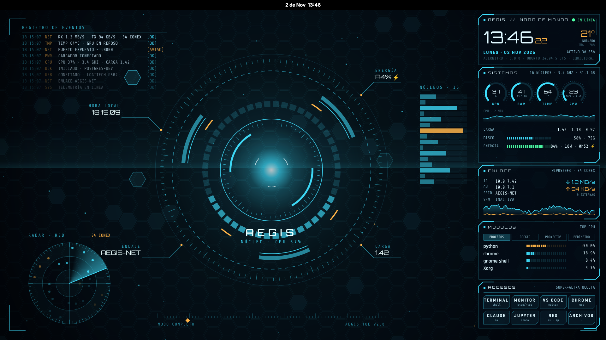
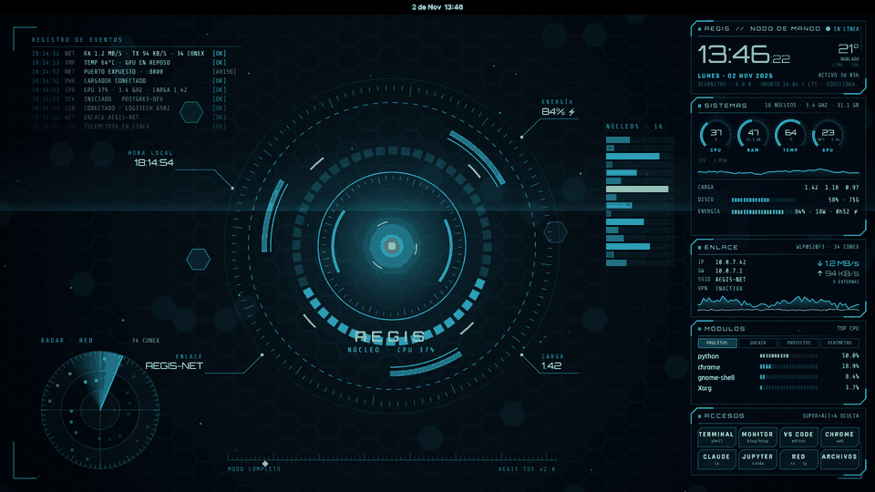
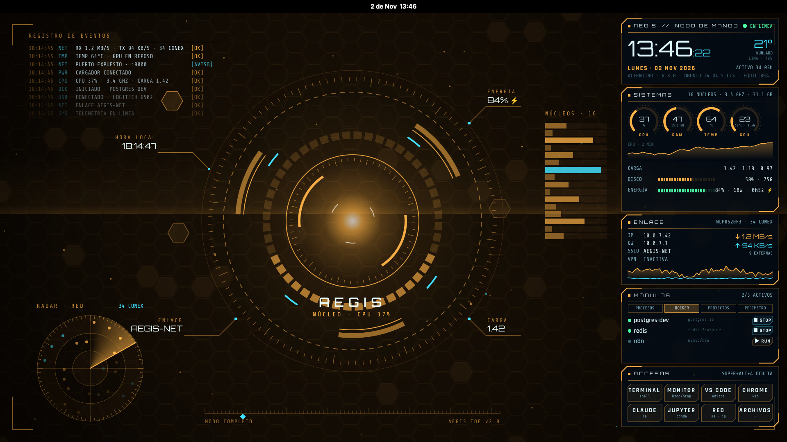
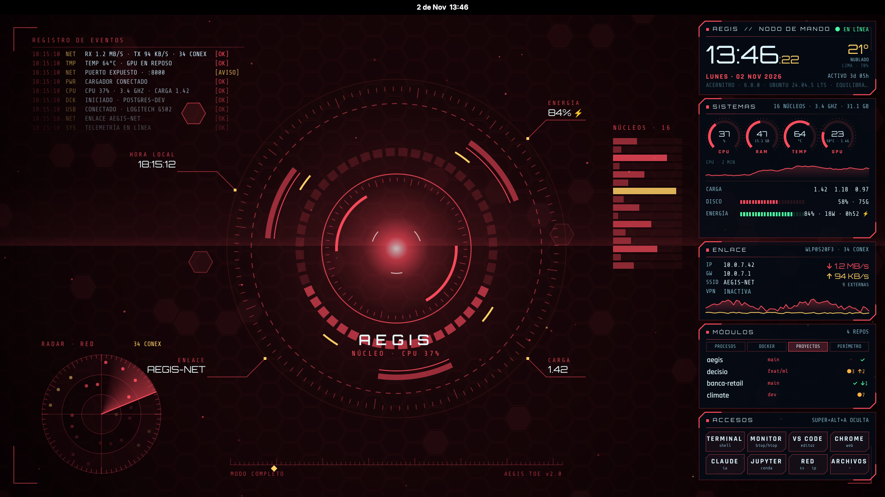
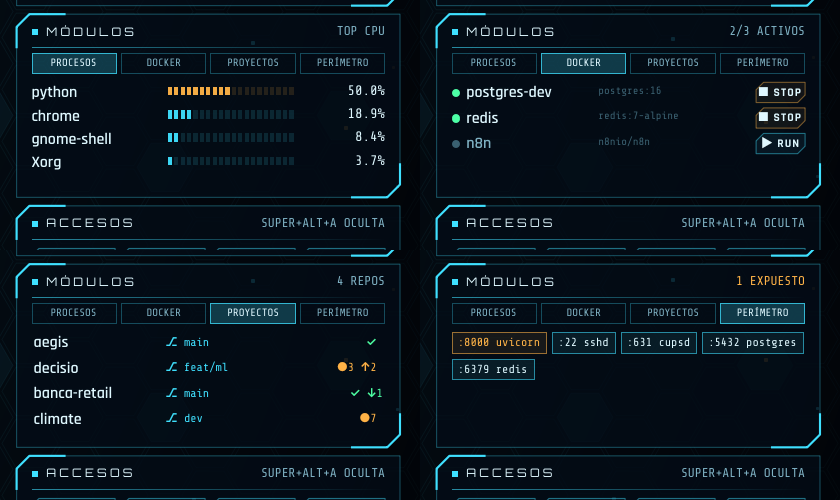

# AEGIS

> Tema de escritorio con estética de centro de mando holográfico para **GNOME** (X11) y **KDE Plasma 6**. Tiene un núcleo animado que reacciona a tu CPU, un radar con tus conexiones de red reales, un registro de eventos del sistema y un HUD con telemetría, Docker, proyectos git, clima y accesos directos. Ahorra batería: se congela cuando una ventana tapa el escritorio.





| Ámbar | Carmesí |
|---|---|
|  |  |

## Todo con datos reales

| Elemento | Qué muestra |
|---|---|
| **Núcleo** | Gira más rápido y brilla más según el uso de CPU. El anillo segmentado se llena con la carga y pasa a ámbar por encima del 85 %. |
| **Núcleos** | Una barra por cada núcleo de tu CPU, con su uso en vivo. |
| **Radar** | Un eco por cada conexión de red activa. Las conexiones a internet salen en ámbar y las de tu red local en cian. |
| **Registro de eventos** | Eventos reales: cargador conectado o desconectado, batería baja, cambio de Wi-Fi o VPN, USB conectado o retirado, temperatura o carga alta, contenedores Docker iniciados o detenidos, y puertos nuevos expuestos a la red. Entre evento y evento, muestra una línea de telemetría. |
| **Etiquetas** | Batería, red actual, carga del sistema y hora local. |

## HUD

| Tarjeta | Contenido |
|---|---|
| Cabecera | Reloj, fecha, clima (Open-Meteo), tiempo encendido, equipo, kernel, sistema y perfil de energía. |
| Sistemas | Medidores de CPU, RAM, temperatura y **GPU** (uso, temperatura y VRAM), con la gráfica de CPU, la carga, el disco y la batería (porcentaje, vatios y tiempo restante). |
| Enlace | IP, gateway, SSID, VPN, tráfico ↓↑ con gráfica y conexiones externas. |
| Módulos | Cuatro pestañas que rotan solas. Si pulsas una, se queda fija un minuto. **Procesos**: los que más CPU usan. **Docker**: tus contenedores, con botones ▶/■. **Proyectos**: tus repositorios git con la rama y los cambios pendientes; un clic lo abre en VS Code. **Perímetro**: puertos en escucha, con los expuestos en ámbar, y servicios caídos. |
| Accesos | Ocho botones configurables. |



## Batería

| Modo | Cuándo | Qué hace |
|---|---|---|
| **completo** | Con el cargador conectado y el escritorio visible | Animación fluida con partículas y destellos. |
| **eco** | Con batería | Dibuja 12 cuadros por segundo, sin partículas, destellos ni línea de escaneo. |
| **pausa** | Cuando una ventana maximizada o a pantalla completa tapa el escritorio | No dibuja nada y lee los datos cada 10 s en vez de cada 2 s. |

La GPU **solo se consulta si ya está despierta**: llamar a `nvidia-smi` con una NVIDIA híbrida dormida la despierta y gasta batería.

## Instalar en GNOME (Ubuntu 22.04 o 24.04, sesión X11)

```bash
git clone https://github.com/blackjaguar-ai/aegis && cd aegis
sudo apt install python3-venv libxcb-cursor0 x11-utils    # solo la primera vez
./instalar-gnome.sh                # o --acento=1 / 2 / 3
```

Funciona como capa de escritorio: va detrás de tus ventanas y no aparece en la barra de tareas ni en Alt+Tab. Usa su propio entorno de Python con PySide6, así que no interfiere con conda, y arranca solo al iniciar sesión. Si actualizas Ubuntu y Python cambia de versión, vuelve a ejecutar `./instalar-gnome.sh`: detecta el entorno roto y lo recrea.

- **Super+Alt+A** muestra u oculta el HUD.
- **Actualizar:** `cd ~/aegis && git pull && ./instalar-gnome.sh`
- **Quitarlo:** `~/.local/share/aegis/desinstalar-gnome.sh` lo apaga y quita el arranque automático y el atajo. Con `--todo` lo borra por completo.
- **Modo fijo:** en `~/.config/aegis/gnome.json`, cambia `"modo": "auto"` por `"completo"` o `"eco"`. La pausa por ventana maximizada sigue activa.

## Configuración: `~/.config/aegis/config.json`

Se crea la primera vez con valores por defecto:

```json
{
  "clima": {"lat": -12.05, "lon": -77.04, "ciudad": "LIMA"},
  "accesos": [
    {"t": "TERMINAL", "s": "shell",  "cmd": "@terminal"},
    {"t": "VS CODE",  "s": "editor", "cmd": "code"},
    {"t": "JUPYTER",  "s": "conda",  "cmd": "@term:bash -ic 'jupyter lab'"}
  ],
  "proyectos": ["~/proyectos", "~/dev", "~/code", "~"]
}
```

- **`clima`:** la ubicación sale de tu zona horaria. Cambia `lat`, `lon` y `ciudad`, o pon `null` para desactivarlo. Es la única llamada de red de AEGIS (Open-Meteo, sin clave, una vez cada 30 minutos).
- **`accesos`:** hasta 8. `t` es el título y `s` el subtítulo. `cmd` puede ser cualquier orden, `@term:ORDEN` para ejecutarla en una terminal, o `@terminal`, `@monitor`, `@red` o `@archivos`.
- **`proyectos`:** las carpetas donde se buscan repositorios git.

Los cambios se aplican en unos 20 segundos, sin reiniciar nada.

## Instalar en KDE Plasma 6

```bash
./instalar.sh                 # acento cian
./instalar.sh --acento=1      # 0 cian, 1 ámbar, 2 carmesí, 3 verde
```

Necesita `python3`, `qdbus6` y `kwriteconfig6`. Solo toca tu usuario y, antes de cambiar nada, guarda una copia de tus ajustes en `~/.local/share/aegis/backup/original/`. En Plasma, el fondo se pone en modo eco con la batería. Para la pausa por ventana maximizada, desactiva la animación en *Configurar fondo de pantalla*.

```bash
~/.local/share/aegis/aplicar.sh acento 2     # cambia el acento del fondo, el HUD y el bloqueo
~/.local/share/aegis/aplicar.sh demo on      # el HUD oculta tu IP y tu red real (para capturas)
~/.local/share/aegis/revertir.sh             # vuelve a tus ajustes anteriores
~/.local/share/aegis/desinstalar.sh --todo   # lo borra todo
```

## Privacidad y permisos

El motor (`hud/.../code/datos.py`) **solo lee** `/proc`, `/sys`, `ip`, `ss`, `ps`, `git`, `docker ps` y `powerprofilesctl`, y nunca usa `sudo`. Con `touch ~/.config/aegis/demo`, el HUD oculta tu IP y tu red reales, útil para capturas. Los botones solo ejecutan lo que tú pongas en `config.json`. Docker solo admite nombres de contenedor válidos.

## Estructura

```
fondo-animado/   escena (Escena.qml: QtQuick puro, un único reloj para todas las animaciones) + plugin de Plasma
hud/             HUD (Panel.qml: QtQuick puro) + datos.py (telemetría) + accion.sh (botones)
gnome/           capa de escritorio para GNOME: aegis-escritorio.py (energía, atajo) + Escritorio.qml
tema/            esquema de color, Konsole y Alacritty
```

## Créditos y licencia

La arquitectura sigue a [PixelZen](https://github.com/mosqui1988/pixelzen): plugins QML, un motor de datos de solo lectura y scripts reversibles. El código y el arte de AEGIS son originales.
El código está bajo licencia GPL-3.0-or-later, y las fuentes tienen licencia SIL OFL 1.1 (ver `licencias/`).
